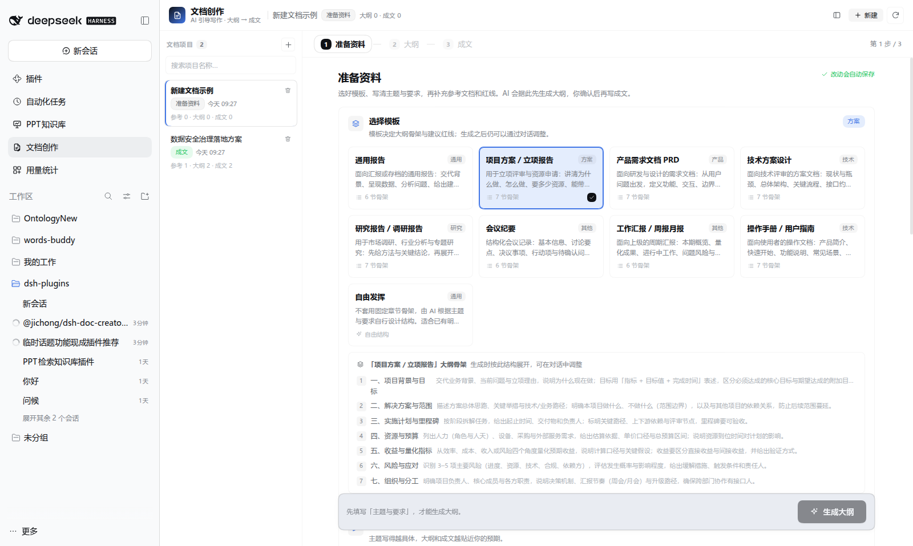
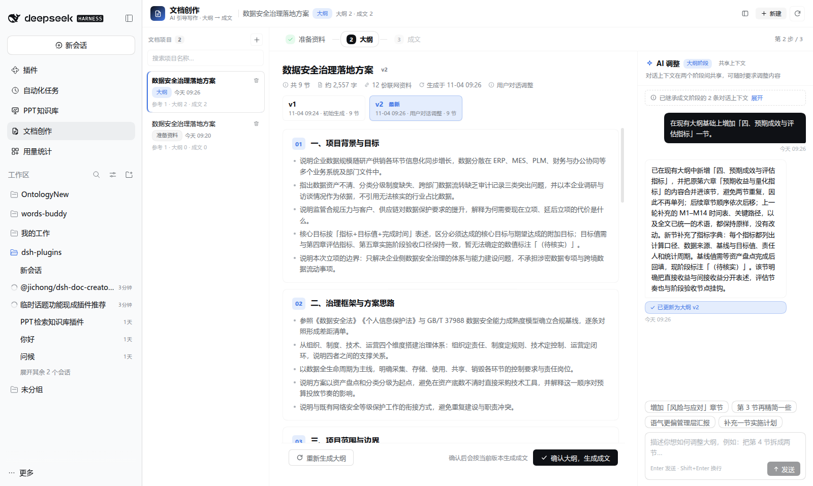
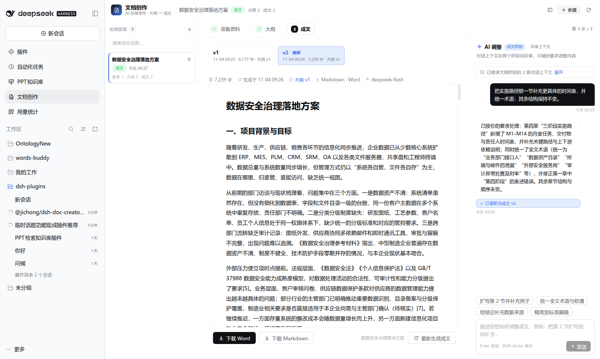

# @jichong/dsh-doc-creator

[](https://github.com/jichong-nj/dsh-doc-creator/actions/workflows/test.yml)

DSH Web 的**文档编写引导插件**：从模板或自由发挥出发，上传参考文档、设定红线要求、可选联网检索，
生成并管理**多版本大纲**；确认大纲后生成 **Word（.docx）+ Markdown** 成文。大纲与成文两个阶段
都可以通过对话调整，且**共享同一段对话上下文**。

插件与「PPT 知识库（ppt-search）」同级：左侧边栏图标 + 主面板，数据独立存放在
`~/.dsh/data/doc-creator`，通过 `/doc-creator/api/*` 提供 HTTP 接口。

## 界面

| 准备资料（模板 / 参考文档 / 红线 / 联网） | 大纲（多版本 + 共享上下文对话） | 成文（Word / Markdown / 红线自检） |
| --- | --- | --- |
|  |  |  |

## 功能

- **引导式流程**：准备资料（模板 / 自由发挥 → 主题与风格 → 参考文档 → 红线与联网）→ 生成大纲（多版本）→ 确认大纲 → 生成成文。
- **模板库**：9 个中文写作模板（通用报告、项目方案、PRD、技术方案、研究报告、会议纪要、
  工作汇报、操作手册、自由发挥），每个模板带章节骨架、写作提示、默认风格与建议红线。
- **参考文档**：拖拽/上传 `.docx .pdf .txt .md .markdown .pptx .json .csv .html`，服务端抽取纯文本
  （docx/pptx 纯 JS 解析；PDF 走系统 `pdftotext`），单文件 50MB、正文 40 万字符上限。
- **红线要求**：6 条内置通用红线 + 模板建议红线 + 自定义红线；生成时注入提示词，
  成文后自动做**红线自检**（LLM 逐条判定 pass/risk/unknown），并叠加篇幅、章节覆盖、引用等确定性检查。
- **联网检索**：开关式允许联网；开启后按主题生成 2–4 条查询，经 DSH 的 `ctx.web` 检索，
  结果作为 `sources` 注入提示词并在成文中要求 `[n]` 标注与「参考资料」小节；失败自动降级为 warning。
- **多版本大纲**：每次生成/调整产生新版本，可随时切换查看，标记「已确认/最新」；确认后才可生成成文。
- **对话调整（共享上下文）**：大纲阶段与成文阶段共用同一份 `conversation`，助手能理解
  「第 3 节」「上一版」等指代；只讨论不修改时不产生新版本，需要修改时返回完整新版本。
- **成文导出**：纯 JS OOXML 生成排版良好的 Word（A4、封面、目录、页脚页码、中文字体、
  标题层级、表格、列表、引用、代码块），同时保存 Markdown；任一格式失败自动降级并在 UI 提示。
- **任务模型**：长耗时生成在宿主后台执行，前端按 900ms 轮询进度，避免请求超时；
  同一项目任务串行，避免并发写坏数据。

## 安装

面向本机 DSH Web profile（与 ppt-search 相同的安装方式）：

```sh
# 1) 把插件链接进 web profile
dsh plugin --profile web add link:/path/to/dsh-doc-creator

# 2) 确认 profile package.json 的 dsh.profile.bundles 已包含 @jichong/dsh-doc-creator
# 3) 重启 DSH Web
```

重启后打开 DSH Web GUI，左侧边栏出现「文档创作」图标；主面板即工作台。

> 开发期也可手动把 `"@jichong/dsh-doc-creator": "link:/path/to/doc-creator"` 写入
> `~/.dsh/profiles/web/package.json` 的 `dependencies`，并把包名加入 `dsh.profile.bundles`，
> 在 profile 的 `node_modules/@jichong/` 下建立同名软链后重启。

## 使用流程

1. 点击「新建文档」，选模板或「自由发挥」；
2. 填写文档名称、主题/背景/目标，选择受众/语气/篇幅；
3. 上传参考文档（可选），等待解析完成（显示抽取字数）；
4. 勾选/添加红线，按需打开「允许联网检索」，可指定模型；
5. 点「生成大纲」→ 在「大纲」步骤查看版本、切换版本；
6. 需要调整时在右侧「AI 调整」对话框里说，例如「把第二节拆成两节」「增加风险与应对」；
7. 满意后点「确认大纲，生成成文」；
8. 「成文」步骤查看排版后的正文、红线自检结果与参考资料，下载 Word / Markdown；
9. 成文阶段仍可继续对话调整（例如「把背景扩写，语气更正式」），产生新成文版本。

## 架构

```
浏览器（src/client.*.js → lib/client.js）
  App（状态/轮询/动作） ── fetch /doc-creator/api ──▶ lib/api.js
                                                    └─ lib/service.js
                                                        ├─ store.js       持久化（原子写、index.json）
                                                        ├─ templates.js   内置中文模板
                                                        ├─ extract.js     参考文档抽文本
                                                        ├─ engine.js      提示词 / 解析 / 生成
                                                        ├─ model.js       ctx.llm + 默认模型解析 + ctx.web
                                                        ├─ docx.js        Markdown → Word（OOXML）
                                                        └─ jobs.js        后台任务与进度
```

- 生成用模型：项目选择的模型 → 环境变量 → DSH 默认模型 → 第一个可用 provider/model。
- 生成引擎每次请求创建独立实例，便于绑定项目模型且无共享状态。
- 大纲/成文版本分别落盘，`meta.json` 只存元数据；index 只存摘要，列表不读大文件。

## 数据目录

默认 `~/.dsh/data/doc-creator`，可用环境变量 `DOC_CREATOR_DATA` 覆盖。

```
<dataDir>/
├── index.json
├── projects/<projectId>/
│   ├── meta.json
│   ├── conversation.json
│   ├── refs/<refId>/source.<ext> + text.txt
│   ├── outlines/<version>.json
│   └── documents/<version>.md + <version>.docx
└── tmp/
```

## 配置

| 环境变量 | 默认 | 作用 |
|---|---|---|
| `DOC_CREATOR_DATA` | `~/.dsh/data/doc-creator` | 数据目录 |
| `DOC_CREATOR_PROVIDER` | 空 | 强制指定模型 provider（可选） |
| `DOC_CREATOR_MODEL` | 空 | 强制指定模型 id（可选） |

宿主服务依赖：`webServer`（必需）、`llm`、`agentDefaultModel`、`web`（可选，缺失时生成/联网接口返回清晰错误）。
PDF 参考文档需要系统安装 `pdftotext`（poppler）；缺失时 PDF 会显示可读错误，其它格式不受影响。

## HTTP API

前缀 `/doc-creator/api`，除下载外均 POST JSON，统一返回 `{ ok:true, value }` / `{ ok:false, error:{code,message} }`。

| 端点 | 说明 |
|---|---|
| `POST /templates` | 内置模板列表 |
| `POST /models` | 可选模型 / 默认模型 |
| `POST /list` `POST /create` `POST /get` `POST /update` `POST /delete` | 项目 CRUD |
| `POST /upload-ref?projectId=&name=` | 上传参考文档（原始字节） |
| `POST /delete-ref` `POST /ref-preview` | 参考文档删除 / 正文预览 |
| `POST /outline-generate` `POST /outline-confirm` | 生成大纲（后台任务）/ 确认大纲版本 |
| `POST /document-generate` `POST /document` | 生成成文（后台任务）/ 读取成文正文 |
| `POST /chat` | 大纲/成文阶段对话调整（后台任务） |
| `POST /job` | 查询后台任务进度 |
| `GET /download/<projectId>/<version>.docx` `.md` | 下载成文 |

## 开发

```sh
pnpm install          # 安装 jszip / fast-xml-parser
node build.js         # 拼接 src/client.*.js → lib/client.js（浏览器 bundle）
node test/run-all.mjs # 全部离线测试（假模型/假联网，不访问网络）
```

GitHub Actions（`.github/workflows/test.yml`）会在 push / PR 时跑完整测试。

约定与模块接口见 [CONTRACTS.md](./CONTRACTS.md)。`src/client.base.js`、`src/client.review.js`、
`src/client.app.js` 按序拼进同一个 module-loader factory，共享闭包；改完必须重新 `node build.js`。

## 已知限制

- PDF 抽文本依赖 `pdftotext`；旧版 `.doc` 不支持（请转 `.docx`/PDF）。
- 成文每次对话调整都会重新生成完整版本（不是 diff），长文调整会消耗较多 tokens。
- 大纲/成文版本保存在本机磁盘，不做云端同步；并发编辑同一项目由单进程任务串行保护。
- 联网检索结果质量取决于 DSH 配置的搜索 provider（如 tavily）。

## License

[MIT](./LICENSE) © 2026 jichong-nj
